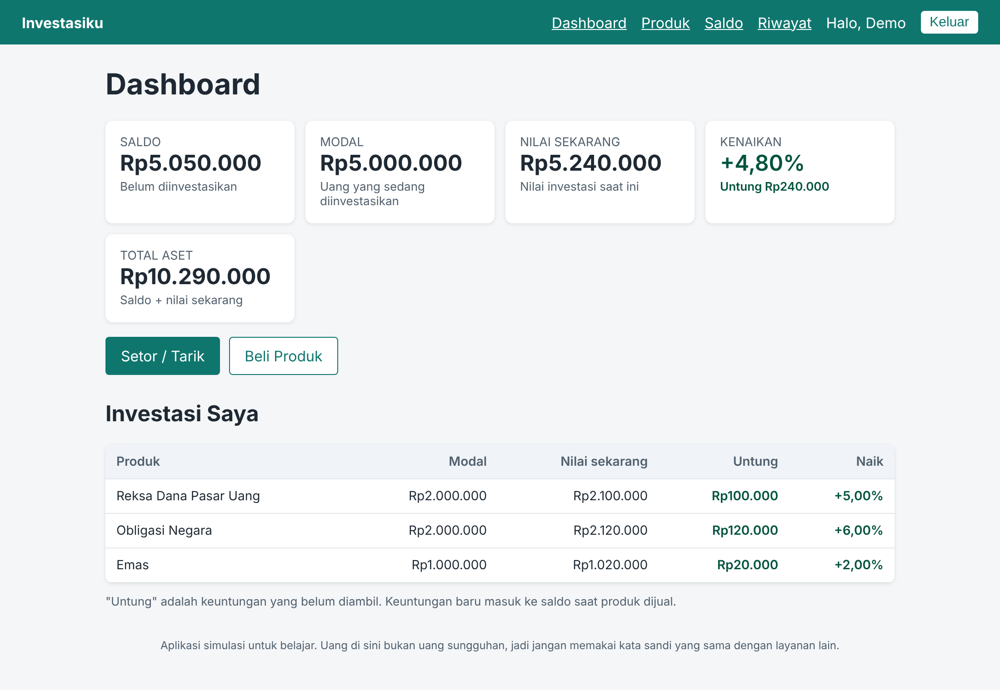
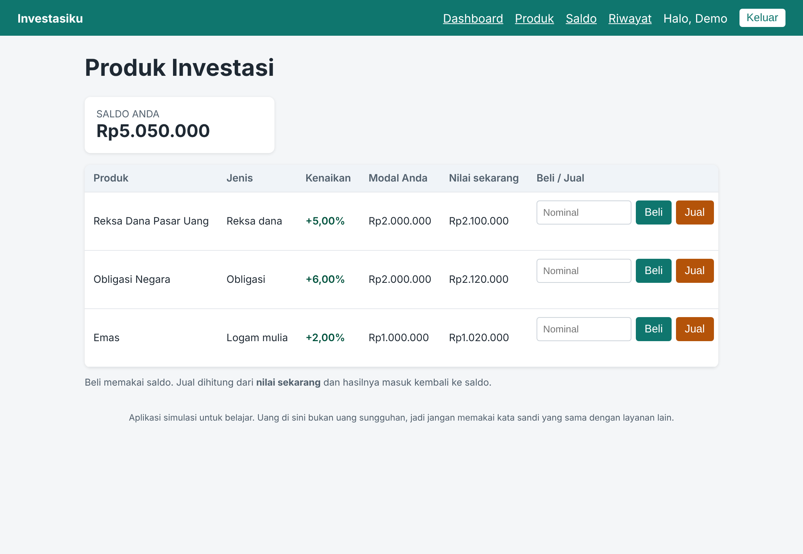
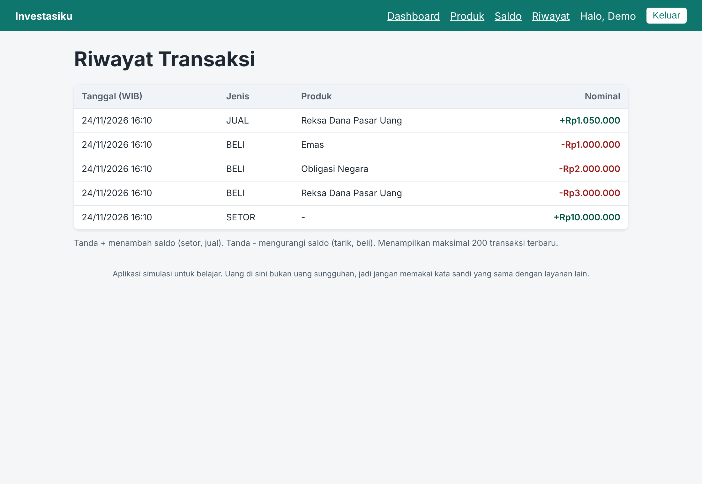
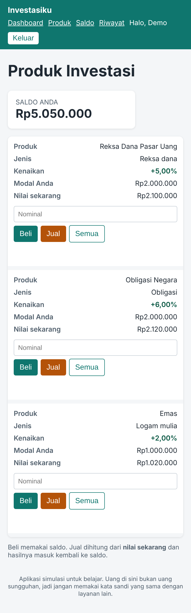

# Investasiku: Aplikasi Simulasi Investasi

Aplikasi web sederhana untuk belajar mencatat uang dan investasi. Pengguna bisa setor, tarik, membeli dan menjual produk investasi, lalu melihat berapa persen nilainya naik. **Semua uang di sini hanya simulasi.**

Demo: `https://NAMAANDA.pythonanywhere.com` (ganti dengan alamat Anda)



## Fitur

- Daftar, login, dan logout (banyak pengguna, data masing-masing terpisah)
- **Saldo**: uang yang sudah disetor tetapi belum diinvestasikan
- Setor dan tarik saldo
- Daftar produk investasi dengan persentase kenaikan
- Beli dan jual produk (jual dihitung dari nilai sekarang)
- Dashboard: saldo, modal, nilai sekarang, kenaikan (%), dan total aset
- Riwayat transaksi (jam ditampilkan dalam WIB)
- Tampilan nyaman di HP

| Produk | Riwayat | Tampilan HP |
|---|---|---|
|  |  |  |

## Teknologi

Python, Flask, Flask-Login, SQLite, HTML, CSS, dan JavaScript. Uji otomatis memakai `unittest`.

## Cara menjalankan (Windows)

```
git clone https://github.com/NAMAANDA/aplikasi-investasi.git
cd aplikasi-investasi
python -m venv venv
venv\Scripts\activate
pip install -r requirements.txt
python app.py
```

Buka `http://127.0.0.1:5000`. Database dibuat otomatis dari `schema.sql` saat pertama dijalankan.

## Menjalankan uji otomatis

```
python -m unittest -v test_app
```

Uji memakai database sementara, jadi `database.db` tidak tersentuh.

## Aturan dan rumus

| Kejadian | Efek |
|---|---|
| Setor | Saldo bertambah |
| Tarik | Saldo berkurang (tidak boleh melebihi saldo) |
| Beli | Saldo berkurang, modal produk bertambah |
| Jual | Saldo bertambah sebesar nominal, modal produk berkurang sebanding bagian yang dijual |

```
Nilai sekarang   = Modal x (1 + Kenaikan% / 100)
Keuntungan       = Nilai sekarang - Modal
Kenaikan total % = Keuntungan / Modal x 100
Total aset       = Saldo + Nilai sekarang
```

Semua uang disimpan sebagai **bilangan bulat rupiah**, dan nilai dihitung dengan `Decimal` (pembulatan ke atas pada .5) supaya tidak ada selisih pembulatan. Setiap kejadian uang dicatat di tabel transaksi dan tidak pernah dihapus. Saldo selalu sama dengan jumlah setor + jual - tarik - beli, dan itu diperiksa oleh uji otomatis.

## Rancangan database

`pengguna`, `saldo`, `produk`, `kepemilikan`, `transaksi`. Lihat `schema.sql`. Pengaman di tingkat database: saldo dan modal tidak boleh negatif, nominal transaksi harus lebih dari 0, dan jenis transaksi dibatasi pada SETOR, TARIK, BELI, JUAL.

## Keamanan

- Kata sandi disimpan sebagai hash (tidak pernah teks biasa)
- Perlindungan CSRF pada semua formulir
- Pembatasan login: 5 kali salah dalam 10 menit
- Kunci rahasia acak (dari environment atau file `rahasia.key`)
- Cookie `HttpOnly` dan `SameSite=Lax` (`Secure` saat memakai HTTPS)
- Header keamanan (CSP, anti-clickjacking, `no-store`)
- Perintah SQL berparameter (mencegah SQL injection), tampilan di-escape (mencegah XSS)
- Seluruh perubahan saldo dan modal berjalan dalam satu transaksi database (semua berhasil atau semua dibatalkan)

## Keterbatasan

- Uang simulasi. Untuk uang sungguhan dibutuhkan izin, kepatuhan OJK, dan audit keamanan profesional.
- Persentase kenaikan produk diubah manual lewat database, belum ada halaman admin.
- Belum ada lupa kata sandi, verifikasi email, atau login dua langkah.
- Catatan percobaan login tersimpan di memori (hilang saat server dimulai ulang).

## Ide pengembangan

Grafik pertumbuhan, laporan bulanan, halaman admin untuk produk, dan ekspor riwayat ke Excel.

## Struktur proyek

```
app.py            Aplikasi Flask (rute, aturan, keamanan)
schema.sql        Definisi tabel dan produk contoh
init_db.py        Membuat database secara manual (opsional)
test_app.py       Uji otomatis
templates/        Halaman HTML
static/           CSS dan JavaScript
screenshots/      Gambar untuk README
requirements.txt  Daftar paket
```
